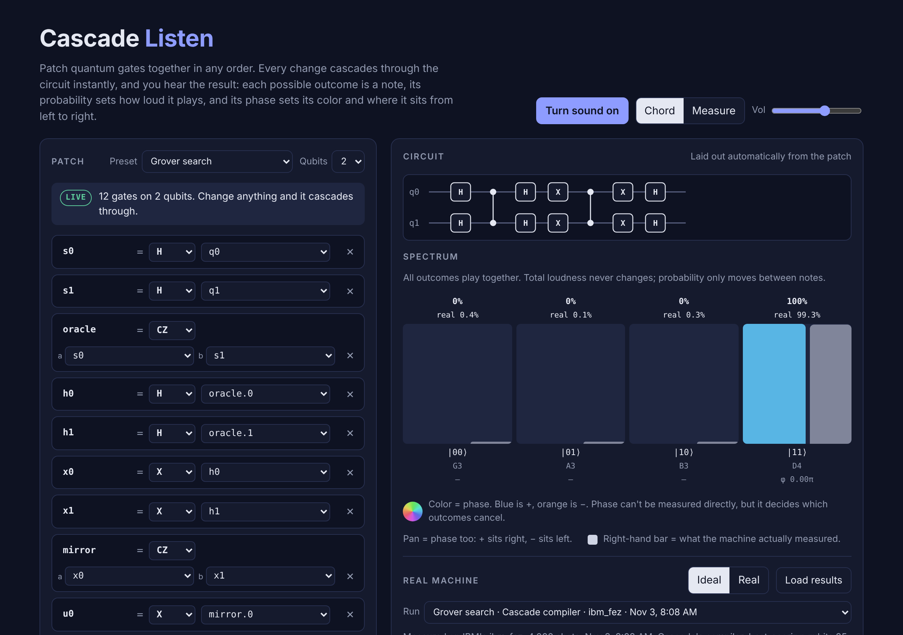

# Cascade

**A reactive quantum circuit language: write gates in any order, the compiler enforces the physics, and you can hear the result. Tested on real IBM quantum hardware.**



Most quantum tools have you write circuits top to bottom, like assembly. In Cascade you
declare named gates and what they connect to, in any order. Cascade builds the
dependency graph, sorts it, simulates it, and re-runs everything downstream whenever
anything changes, the way a spreadsheet does.

```python
from cascade import Cascade, H, CX

c = Cascade(2)
c["entangle"] = CX("spread", "q1")   # refers to a gate that doesn't exist yet: Cascade waits
c["spread"]   = H("q0")              # graph complete: it runs
print(c)
```
```
q0: ─H──●──
q1: ────⊕──
  |00>   50.0%  ███████████████
  |11>   50.0%  ███████████████
```

The compiler knows quantum rules. A qubit's state can't be copied (the no-cloning theorem),
so wiring one output into two gates is a compile error and the edit is rolled back:

```
NoCloningError: wire 'a' feeds both 'copy1' and 'copy2' — a qubit's state can't be copied
```

## Results on real quantum hardware

Every circuit here has run on IBM's 156-qubit Heron processors through the free
[IBM Quantum](https://quantum.cloud.ibm.com) Open Plan. Raw data is in [`results/`](results/).

### Cascade's compiler vs. IBM's default (ibm_fez, Nov 3 2026, 4,000 shots each, same session)

| Circuit | IBM default compile | Cascade compiler | Gain |
|---|---|---|---|
| Bell pair | 98.5% | **99.9%** | +1.3 pts |
| Grover search | 96.8% | **99.3%** | +2.4 pts |
| GHZ (3-qubit) | 96.2% | **97.5%** | +1.3 pts |

"Match" is the classical fidelity between measured and ideal outcome distributions.

The Cascade compiler ([`mitigate.py`](mitigate.py)) does three things:

1. **Noise-aware placement**: compiles each circuit 25 ways and keeps the one with the best
   predicted success from the machine's live calibration data. (On this run it chose the same
   qubits as IBM's compiler, so the gain came from the next two steps.)
2. **Readout correction**: runs two calibration circuits on the exact physical qubits used,
   measures each qubit's misread rates, and inverts that bias.
3. **Dynamical decoupling**: pulse pairs in idle moments to cancel drift.

### First run, all presets (ibm_kingston, Nov 3 2026, 2,000 shots, default compile)

| Circuit | Match with ideal |
|---|---|
| Interference dial | 100.0% |
| Phase rainbow (8 outcomes) | 100.0% |
| GHZ chord | 95.5% |
| Bell pair | 95.4% |
| Grover search | 91.9% |

## Cascade Listen

[`cascade_listen.html`](cascade_listen.html) is a browser instrument for the language. Open it in any
browser, no install needed. You patch gates together and hear the circuit:

- each possible measurement outcome is a note (G major pentatonic);
- oscillator amplitude = |quantum amplitude|, so loudness = probability and total loudness never changes;
- phase, which measurement can't see, becomes color and stereo position, so you can watch and hear interference;
- **Real** mode plays what IBM's machine actually measured, including the noise, and Measure mode
  replays the machine's shots in the order they came out.

It exports any patch to OpenQASM 3, to `cascade.py` code, or to a patch file that `run_ibm.py` can send to IBM.

## Run it yourself

```bash
pip install -r requirements.txt
python demo.py                 # four short demos
python -m pytest tests         # test suite
```

### On a real IBM quantum computer (free)

1. Create a free account at [quantum.cloud.ibm.com](https://quantum.cloud.ibm.com) (Open Plan, us-east) and copy your API key.
2. Save the key as plain text in `ibm_key.txt` in this folder. It's in `.gitignore` and never leaves your machine.
3. On a Mac, double-click `run_on_ibm.command` (all presets) or `compare_on_ibm.command`
   (default vs. Cascade compiler). Or from a terminal:

```bash
python run_ibm.py                        # all presets on the least busy machine
python run_ibm.py --compare              # IBM default vs. Cascade compiler, side by side
python run_ibm.py --patch my_patch.json  # your own circuit, exported from Cascade Listen
python run_ibm.py --fake                 # noise model of ibm_kingston, no account (pip install qiskit-aer)
```

Results land in `results/`. Load them in Cascade Listen with **Load results**.
A full run uses a few seconds of the Open Plan's 10 free minutes per 28 days.

## Files

| File | What it is |
|---|---|
| `cascade.py` | The language: gates, graph compiler, statevector simulator, Qiskit export |
| `mitigate.py` | The noise-fighting compiler: placement scoring, readout correction |
| `run_ibm.py` | Sends circuits to IBM Quantum and saves results |
| `cascade_listen.html` | The browser instrument |
| `demo.py` | Demos: out-of-order code, interference, Grover search, no-cloning |
| `tests/` | Test suite |
| `results/` | Real hardware runs (plus one clearly labeled noise-model sample) |

## Where this is going

Cascade is an experiment in what a quantum language should feel like to write: graph-shaped,
live, and strict about physics at compile time. Next up:

- a drag-and-wire editor in Cascade Listen
- automatic uncomputation (cleaning up temporary qubits), which fits a graph model naturally
- export to HUGR, the graph-based format behind Quantinuum's Guppy, alongside OpenQASM 3

## License

MIT © 2026 Skyler Hall
